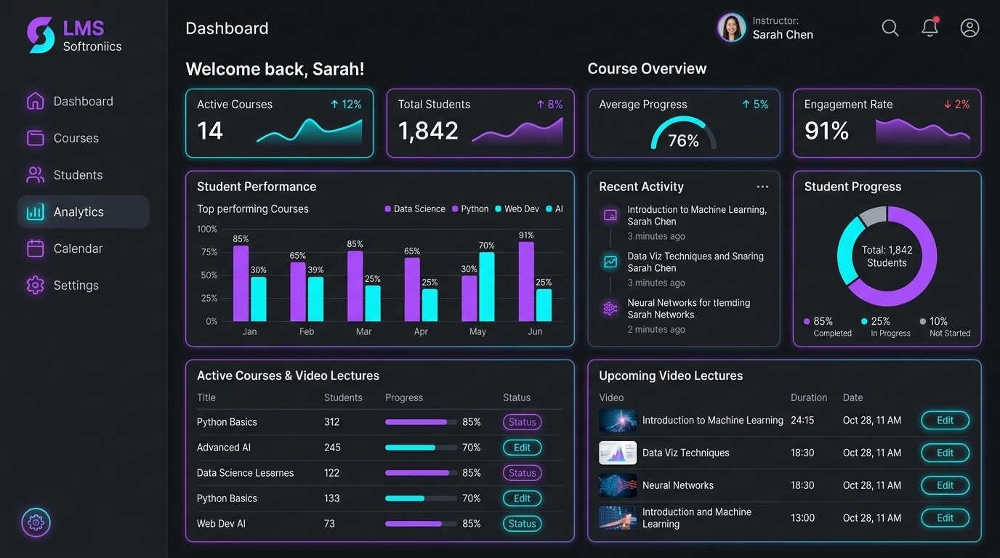

# 💼 ANAMIKA O - Personal Portfolio Website

A modern, responsive, dark-themed personal portfolio website built with **HTML5**, **CSS3**, **Bootstrap 5**, and **JavaScript**. Tailored for a **Data Analyst**, fresher, or software developer to showcase skills, projects, education, and contact details.



---

## 🌟 Features

- 🌓 **Modern Dark Theme Aesthetic**: Built with deep black tones (`#07080d`), glassmorphism, and neon violet (`#8b5cf6`) & cyan-blue (`#3b82f6`) accent glows.
- 📱 **Fully Responsive**: Adapts seamlessly to all screen sizes (mobile smartphones, tablets, laptops, and ultra-wide desktops) using Bootstrap 5 grid and flex utilities.
- ⚡ **Dynamic Hero Section**: Interactive typewriter effect dynamically highlighting key roles, glowing avatar card, and quick social links.
- 📊 **Tailored Data Analyst Skills**: Interactive skill cards with progress bars and badges for **PYTHON**, **SQL**, **POWER BI**, **EXCEL**, and **GIT & GITHUB**.
- 🚀 **Featured Project Showcase**:
  - **Car Sales Data Analysis**: An end-to-end exploratory data analysis (EDA) pipeline utilizing Python, Pandas, NumPy, Matplotlib, and Seaborn to model price depreciation, brand market share, and vehicle resale trends.
- 🎓 **Education Timeline**: Degree (2023–2026), Data Analytics Certification (2026), and P R M Kolavallur HSS (Biology Science stream).
- ✉️ **Interactive Contact Form & Direct Email**: Direct link to `anamikaambadi3@gmail.com` with client-side form validation.
- 🔝 **Back to Top Button**: Floating scroll-to-top button with smooth scrolling.
- 🪶 **Zero Heavy Frameworks**: Pure Vanilla HTML/CSS/JS + Bootstrap 5 CDN.

---

## 📁 Project File Structure

```text
portfolio/
├── index.html              # Main HTML5 structure with Bootstrap 5 CDN
├── style.css               # Custom dark theme styles, animations, and variables
├── script.js               # Typewriter effect, form validation, modal and UI interactions
├── README.md               # Beginner documentation & deployment guide
└── assets/
    └── images/
        ├── profile.jpg          # Authentic profile portrait
        └── project-carsales.jpg  # Car Sales Data Analysis preview dashboard
```

---

## 🚀 How to Run & Preview the Website

You can view the portfolio immediately using any of these simple methods:

### Method 1: Direct Browser Opening (Easiest)
1. Open your file explorer and navigate to the project folder:
   `c:\Users\ANAMIKA\Downloads\portfolio`
2. Double-click on **`index.html`** or right-click -> **Open with Google Chrome / Edge / Firefox**.

---

### Method 2: Using Live Server in IDE (Recommended)
1. In your editor (Antigravity IDE or VS Code), install the **Live Server** extension.
2. Right-click on `index.html` and click **"Open with Live Server"**.
3. The portfolio will launch automatically at `http://127.0.0.1:5500`.

---

### Method 3: Using Python HTTP Server (Terminal)
Open PowerShell or your command prompt in the project folder and run:

```bash
# Python 3
python -m http.server 8000
```
Then visit [http://localhost:8000](http://localhost:8000) in your browser.

---

## 🛠️ How Beginners Can Customize This Portfolio

### 1. Change Personal Name & Title
- Open `index.html`:
  - Search for `ANAMIKA O` and replace with your name.
  - Search for `DATA ANALYST` and edit the default headline.
- Open `script.js`:
  - Find the `roles` array (around line 17) and customize the titles for the typewriter effect:
    ```javascript
    const roles = [
      'DATA ANALYST',
      'PYTHON DEVELOPER',
      'BUSINESS INTELLIGENCE SPECIALIST'
    ];
    ```

### 2. Update Skills & Percentages
- In `index.html`, locate the `#skills` section.
- You can change skill names, tool badges, and update the progress bar width:
  ```html
  <div class="progress-bar progress-gradient" role="progressbar" style="width: 90%;"></div>
  ```

### 3. Replace Profile Picture & Project Images
- Replace `assets/images/profile.jpg` with your own photo (recommended: square 1:1 ratio image).
- Replace the project screenshots inside `assets/images/` with your own project screenshots.

### 4. Connect the Contact Form to Receive Real Emails
By default, the contact form validates submissions locally. To send submissions directly to your email inbox:
1. Sign up for free at [Formspree.io](https://formspree.io).
2. Create a new form and copy your endpoint URL (e.g. `https://formspree.io/f/xvonzxyz`).
3. In `index.html`, update the `<form>` tag:
   ```html
   <form id="portfolio-contact-form" action="https://formspree.io/f/YOUR_ENDPOINT_ID" method="POST">
   ```
   Or use [EmailJS](https://www.emailjs.com/) for zero-redirect email sending.

---

## 🌐 Free Deployment Options

1. **GitHub Pages**:
   - Create a repository named `portfolio` on GitHub.
   - Push these files (`index.html`, `style.css`, `script.js`, `assets/`).
   - Go to **Settings > Pages** -> Select branch `main` and root `/` -> Save. Your website will be live at `https://yourusername.github.io/portfolio/`.
2. **Vercel or Netlify**:
   - Drag and drop this folder onto [Netlify Drop](https://app.netlify.com/drop) or import to [Vercel](https://vercel.com) for instant free HTTPS hosting.

---

## 📜 License
This project is open-source and free to use for personal portfolios, student showcases, and educational workshops.
